# C64GB

**A Game Boy and Game Boy Color emulator for the Commodore 64 Ultimate, written entirely in 6502 assembly.**

C64GB runs original Game Boy (`.gb`) and Game Boy Color (`.gbc`) ROMs on a
Commodore 64. It uses the turbo CPU modes of the Commodore 64 Ultimate and its 16 MB
RAM Expansion Unit. A built-in file browser loads ROMs straight from USB or SD
through the Ultimate Command Interface, so you don't need a PC.

<p align="center">
  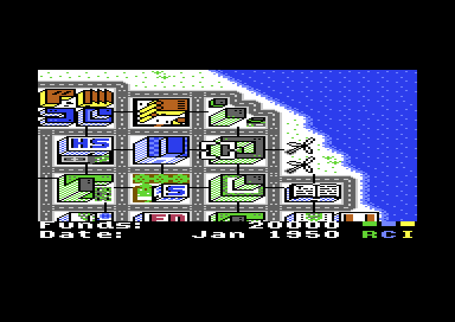
  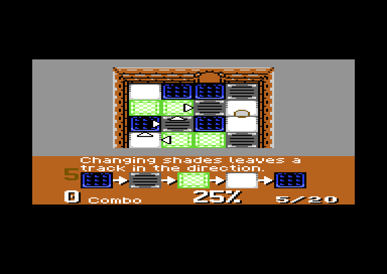
</p>

> Status: early but promising. The CPU core passes Blargg's `cpu_instrs` and
> `instr_timing` test ROMs. The renderer matches the `dmg-acid2` reference image
> pixel for pixel, and Game Boy Color games run in colour. Development so far has
> used sim65 and VICE. Testing on real C64 Ultimate hardware is the next step.

## Screenshots

All screenshots are captured from VICE running the actual C64 binary at 2× scale.
They include the C64 border and the black margins around the 160×144 Game Boy screen.

| | |
|---|---|
| 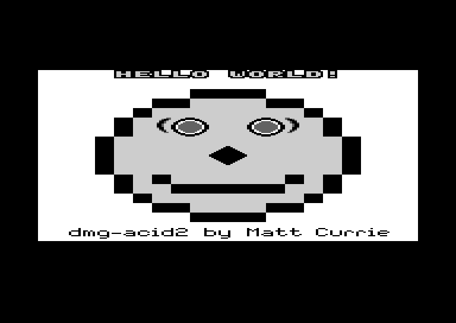 | 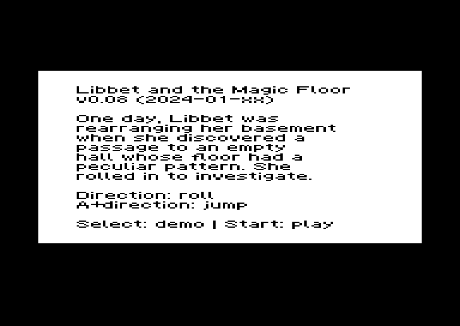 |
| **dmg-acid2**, the standard PPU accuracy test: background, window, sprites, priorities, flips, 8×16 sprites and mid-frame register changes | **Libbet and the Magic Floor** by Damian Yerrick |
| 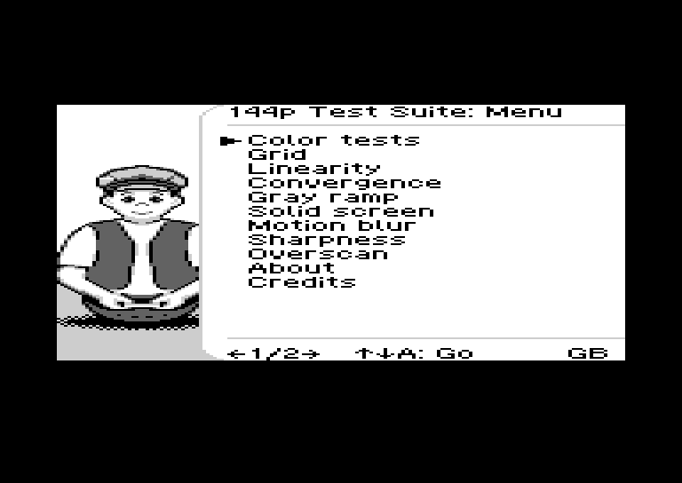 | 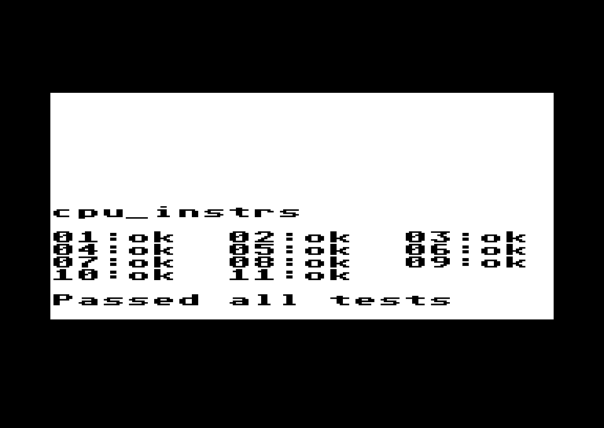 |
| **144p Test Suite** menu (Artemio Urbina & Damian Yerrick) | **Blargg's cpu_instrs**: all 11 CPU tests pass on the C64 |

### Pixel-exact rendering

The C64's multicolor bitmap mode has double-wide pixels and is exactly 160 pixels
wide, the same as the Game Boy screen. Each Game Boy pixel therefore maps onto one
C64 pixel, and the four Game Boy shades map onto C64 white, light grey, dark grey and
black. The Game Boy frame extracted from the C64 output (left) is identical to the
official `dmg-acid2` reference image (right). In the test, 0 of the 23,040 pixels differ.

<p align="center">
  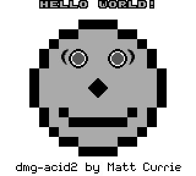
  &nbsp;&nbsp;&nbsp;
  
</p>

### Game Boy Color

Game Boy Color ROMs run in colour. Each GBC colour (15-bit RGB) is converted to the
nearest of the 16 C64 colours. In multicolor mode every 4×8 cell can show three
colours of its own plus one shared background colour. For each GBC palette, C64GB
gives each distinct colour its own slot. Only a palette with four different colours,
none of them the background, has to merge one colour into its nearest neighbour.

Sprites get colour slots too. For every cell a sprite covers, C64GB checks which
colours the sprite really draws there and which colours the background pixels of
that cell really use. Slots the background does not need go to the sprite's colours.
Sprite pixels then use the nearest of the cell's four actual colours.

| | |
|---|---|
| 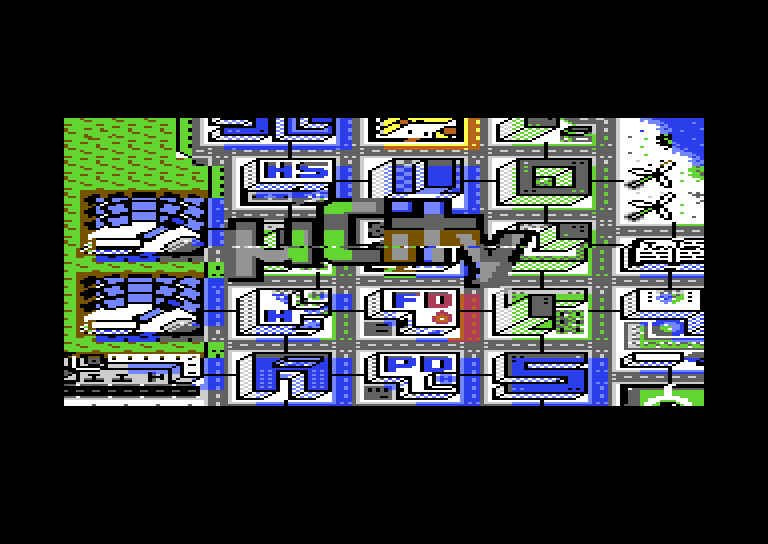 | 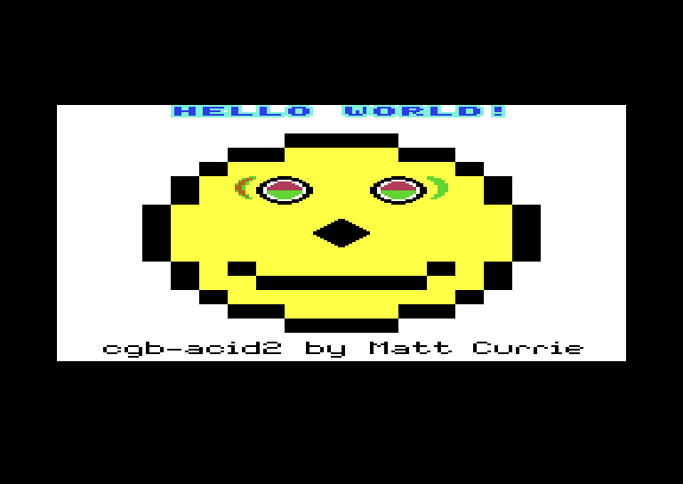 |
| **µCity** by Antonio Niño Díaz, a city builder for the Game Boy Color | **cgb-acid2**: tile attributes, VRAM banks, flips and priorities |

The 16-colour palette and the 4×8 colour cells limit fidelity. Compare C64GB's
cgb-acid2 (above) with the reference image:

<p align="center">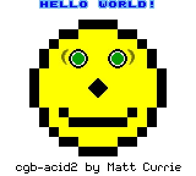</p>

The face, outline, nose, mouth and the blue "HELLO WORLD!" sprites are right. Where
a cell needs more than four colours, some pixels get the nearest available colour.
This happens around the eyes, for example.

## Features

- **LR35902 CPU core**: all 256 opcodes plus the CB prefix, with exact
  instruction timing. It passes all 11 Blargg `cpu_instrs` tests and `instr_timing`.
- **Memory bank controllers**: MBC1, MBC2, MBC3 and MBC5. ROMs up to 8 MB are
  streamed from the REU through a 256-byte page cache.
- **Timers, interrupts, HALT and the EI delay** are driven by a cycle-exact event
  scheduler. Timer overflows are scheduled on the exact cycle.
- **Scanline renderer**: background, window and up to 10 sprites per line. It supports
  priorities, X/Y flips, 8×16 sprites, palettes, fine horizontal scrolling and raster
  effects (register changes in the middle of a frame).
- **ROM browser**: lists folders and `.gb`/`.gbc` files on the Ultimate's USB/SD
  storage and loads the chosen ROM into the REU with `DOS_CMD_LOAD_REU`.
- **Game Boy Color mode** for GBC and dual-mode ROMs:
  - 2 VRAM banks and tile attributes (palette, bank, flips, priority)
  - 8 + 8 colour palettes converted to C64 colours
  - WRAM banks 1–7, swapped through the REU
  - general and HBlank DMA (HDMA)
  - double-speed mode
- **Cartridge RAM** in the REU, paged through the same cache with write-back.
- **Sound through the SID**:
  - GB pulse channels 1 and 2 play on SID voices 1 and 2, with duty → pulse width and
    the channel 1 frequency sweep
  - the noise channel, or else the wave channel (as a triangle), plays on voice 3
  - volume envelopes, length counters, panning and master volume are handled
- **Joystick and keyboard input.** Press RESTORE to return to the browser.

## Running it on a Commodore 64 Ultimate

1. In the Ultimate menu, set:

   | Setting | Value |
   |---|---|
   | RAM Expansion Unit | **Enabled**, 16 MB |
   | Command Interface | **Enabled** |
   | Turbo Control | **U64 Turbo Registers** (C64GB selects the speed itself) |

2. Copy `build/c64gb.prg` and your `.gb` files to a USB stick or SD card. You can
   also send the program over the network with `make deploy U64=<ip-address>`.
3. Start `c64gb.prg`. Pick a ROM with the joystick or the cursor keys and press fire or
   RETURN. `←` goes to the parent folder.

| Game Boy | C64 |
|---|---|
| D-pad | Joystick in port 2 |
| A | Fire |
| B | Space |
| Start | RETURN |
| Select | Left SHIFT |
| *back to the ROM browser* | RESTORE |

If the Command Interface is disabled, C64GB runs the ROM that is already in the REU.
This is the mode used for testing in VICE.

## Building

The build uses only tools inside the project folder. One script fetches and builds them:

```sh
tools/setup.sh      # builds cc65 from source, fetches VICE 3.10 and the test ROMs
make                # build/c64gb.prg (C64) and build/c64gb-sim.bin (headless tests)
make test           # Blargg cpu_instrs + instr_timing in the sim65 simulator
make bench          # C64 cycles per Game Boy cycle, with and without rendering
make run ROM=game.gb            # VICE with the ROM in a 16 MB REU
make deploy U64=192.168.1.64    # send the PRG to a C64 Ultimate via its REST API
```

The setup script downloads the macOS (arm64) build of VICE. On other platforms,
install VICE yourself and set `X64SC` in the `Makefile`.

## How it works

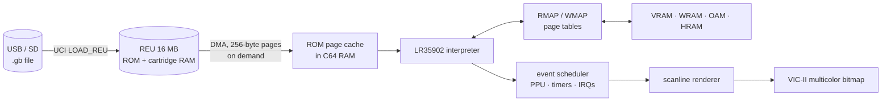

- **Page tables.** Every 256-byte page of the Game Boy address space has an entry in
  a read table and a write table. The entry holds the C64 page that backs it, or 0
  for "special", such as I/O, MBC registers or a ROM page that is not loaded yet.
  A normal memory access costs about 15 cycles.
- **ROM page cache.** The ROM lives in the REU. Pages are copied into free C64 RAM
  by DMA when they are first touched. Slots are tagged with their REU address, so a
  bank switch only invalidates 64 table entries.
- **Event scheduler.** Instructions subtract their cycle count from a budget. When the
  budget runs out, the PPU, timers and interrupts catch up, and the next event is
  scheduled. When the CPU executes `HALT`, the emulator skips straight to the next event.
- **Renderer.** At the start of each HBlank the current line is converted into the
  multicolor bitmap. Lookup tables turn two Game Boy bitplanes into four packed C64
  pixels in a single step.
- **Two targets from one source.** `sim65` runs the same core headless on the host
  for automated tests and cycle counting. The C64 build adds the REU, VIC and Ultimate
  support.

More detail is in [docs/PLAN.md](docs/PLAN.md).

## Performance

Measured in sim65 (`make bench`) as C64 cycles per emulated Game Boy machine cycle:

| Workload | Cycles | at 48 MHz | at 64 MHz |
|---|---|---|---|
| CPU-heavy test ROM, no rendering | 42.4 | 108% | 144% |
| CPU-heavy, every frame rendered | 64.3 | 71% | 95% |
| dmg-acid2 (DMG, many sprites), every frame rendered | 60.6 | 76% | 101% |
| Libbet (GBC mode), every frame rendered | 74.4 | 62% | 82% |
| cgb-acid2 (GBC, many sprites), every frame rendered | 85.7 | 53% | 71% |

The C64 build paces itself with a CIA timer:
- **Ahead of real time:** it waits, so games never run faster than on a Game Boy.
- **More than a frame behind:** it skips rendering frames (at most three in a row) to
  keep the game at the right speed. Real speed therefore sits between the "no
  rendering" and "every frame rendered" figures.

Game Boy Color games that switch to double-speed mode need twice the CPU time.

`tools/profile.py rom.gb [frame] [frames] [render]` traces the emulator in sim65 and
prints C64 cycles per routine. It is how the hot spots above were found and reduced:
- a zero page dispatcher, where the GB program counter is the operand of the opcode fetch
- tighter tile column loops
- sprite plotting that walks the bitmap instead of recomputing addresses per pixel
- stack fast paths

## Roadmap

- [x] CPU core, MBCs, timers and interrupts
- [x] Scanline renderer with sprites and window, pixel-exact on dmg-acid2
- [x] ROM browser via the Ultimate Command Interface
- [ ] Testing on real C64 Ultimate hardware
- [x] Performance work, round 1 (profiler, dispatcher, renderer, sprites)
- [x] Real-time pacing with adaptive frame skip
- [ ] Performance work towards full speed (pre-converted tile cache)
- [x] Sound through the SID (first version)
- [ ] Save games to SD (`DOS_CMD_SAVE_REU`)
- [x] Game Boy Color support (approximated with the 16 C64 colours)
- [x] Sprite-aware GBC colour cells: background slots a cell doesn't use go to sprite colours

## Credits

- Test ROMs: [Blargg's Game Boy tests](https://github.com/retrio/gb-test-roms),
  [dmg-acid2](https://github.com/mattcurrie/dmg-acid2) and
  [cgb-acid2](https://github.com/mattcurrie/cgb-acid2) by Matt Currie (MIT).
- Homebrew shown in the screenshots:
  [Libbet and the Magic Floor](https://github.com/pinobatch/libbet) by Damian Yerrick (zlib)
  and the [144p Test Suite](https://github.com/pinobatch/240p-test-mini) by Artemio Urbina
  and Damian Yerrick (GPL-2.0), and [µCity](https://github.com/AntonioND/ucity) by
  Antonio Niño Díaz (GPL-3.0). The ROMs are not included in this repository.
- Toolchain: [cc65](https://github.com/cc65/cc65). Emulator for testing:
  [VICE](https://vice-emu.sourceforge.io/).
- Hardware documentation: [Ultimate documentation](https://1541u-documentation.readthedocs.io/)
  and [Pan Docs](https://gbdev.io/pandocs/).
