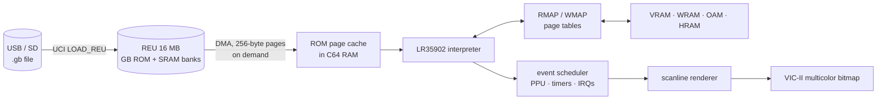

# C64GB – design and roadmap

Goal: a Game Boy (DMG) emulator written entirely in 6502 assembly that runs on the
**Commodore 64 Ultimate** and loads `.gb` ROMs straight from USB/SD.

## 1. Hardware assumptions

| Part | How it is used |
|---|---|
| 6510 CPU in turbo mode (up to 48/64 MHz) | Register `$D031` (bits 0-3 speed, bit 7 = no badline stalls). Requires *Turbo Control = U64 Turbo Registers* in the menu. |
| REU (16 MB) | Holds the complete Game Boy ROM (max 8 MB) and the cartridge RAM banks. |
| Ultimate Command Interface (UCI) | `DOS_CMD_LOAD_REU` loads a `.gb` from USB/SD directly into the REU; `SAVE_REU` will store save games. Requires *Command Interface = Enabled*. |
| VIC-II multicolor bitmap | 160×200 – exactly as wide as the Game Boy screen (160×144). Four shades: white, light grey, dark grey, black. |
| SID | Two pulse channels + noise from the four GB channels; the wave channel approximated. |
| Joystick port 2 + keyboard | D-pad + A (fire); B = Space, Start = RETURN, Select = left SHIFT. |

Cycle budget: 48 MHz / 1.05 MHz (GB machine cycle) ≈ **45 C64 cycles per GB cycle**
(≈ 60 at 64 MHz). An average GB instruction takes ~2 machine cycles, leaving
~90–120 C64 cycles per emulated instruction including rendering.

## 2. Architecture

* **Page tables** `RMAP`/`WMAP` (256 bytes each) give, per 256-byte GB page, the C64
  page that holds it, or 0 for "special" (I/O, MBC registers, cache miss). A memory
  access costs ~15 cycles: `ldx hi / lda RMAP,x / sta ptr+1 / lda (ptr),y`.
* **ROM page cache**: ROM pages are DMA'd from the REU into free C64 RAM slots on
  demand. Each slot is tagged with its REU page number, so bank switches only clear
  64 table entries and previously loaded pages are reused.
* **CPU core**: interpreter with a 256-entry jump table, GB registers in zero page,
  lazy flags (Z kept as the result byte, C/H/N separately).
* **Time**: a `budget` counter of M-cycles counts down to the next event. At zero,
  `do_event` advances the PPU mode/LY, timers (scheduled exactly on TIMA overflow),
  interrupts, the EI delay and HALT.
* **PPU**: scanline renderer at the start of each HBlank: background, window and
  sprites are converted into the multicolor bitmap with lookup tables, so mid-frame
  register changes (raster effects) work.
* **Back ends**: `sim` (sim65 on the host, ROM read from a file – automated tests and
  cycle measurements) and `c64` (REU + VIC + Ultimate).

## 3. Milestones

| # | Milestone | Done when | Status |
|---|---|---|---|
| 0 | Tooling inside the project (cc65, VICE, test ROMs), Makefile | `make` builds both targets | ✅ |
| 1 | CPU core, memory, MBC1/2/3/5, timers, interrupts | Blargg `cpu_instrs` 01–11 pass in sim65 | ✅ + `instr_timing` |
| 2 | C64 target: REU back end, renderer, joystick | Test ROM visible in VICE | ✅ `dmg-acid2` matches the reference |
| 3 | UCI file browser: pick a `.gb` on USB/SD → REU | ROM loads on a real Ultimate without a PC | built, untested on hardware |
| 4 | Sprites, window, palettes, frame skip, fine SCX scroll | Homebrew games playable | all but fine SCX scroll |
| 5 | Performance: profile in sim65, threaded dispatch, tile cache | ≥ 90% speed at 48 MHz | |
| 6 | Sound via SID | Recognisable music | |
| 7 | Cartridge RAM saves via `SAVE_REU`, basic MBC3 RTC | Games can save | |
| 8 | Accurate STAT/mode-3 timing | Raster-effect games correct | |
| 9 | (Optional) Game Boy Color | Colours approximated with the 16 C64 colours | |

## 4. Risks / to be measured on real hardware

1. **REU DMA speed in turbo mode**: does DMA run at 1 MHz or faster? Determines the
   cost of a cache miss (256 bytes).
2. **Badlines/VIC cycle stealing in turbo**: how much of the 48 MHz is left with the
   bitmap enabled?
3. **Bank-switch-heavy games** (e.g. Pokémon): the cache lookup should become hash based.
4. Timing-sensitive games (mid-scanline effects) need milestone 8.

## 5. Measurements (sim65, `make bench`)

| Situation | C64 cycles per GB cycle | 48 MHz | 64 MHz |
|---|---|---|---|
| CPU heavy (Blargg 09), no rendering | 51.9 | 88% | 117% |
| CPU heavy, every frame rendered | 76.7 | 60% | 80% |
| dmg-acid2 (many sprites), every frame | 62.7 | 73% | 97% |
| Libbet, every frame | 69.1 | 66% | 88% |

The C64 build renders every 2nd frame by default, so real figures sit in between.
Biggest wins for milestone 5: threaded dispatch (fetch + dispatch inside every handler),
a pre-converted tile cache for the background, and byte-wise sprite masks instead of
per-pixel plotting.
