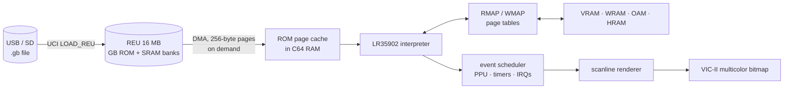

# C64GB – design and roadmap

Goal: a Game Boy (DMG) emulator written entirely in 6502 assembly that runs on the
**Commodore 64 Ultimate** and loads `.gb` ROMs straight from USB/SD.

## 1. Hardware assumptions

| Part | How it is used |
|---|---|
| 6510 CPU in turbo mode (up to 48/64 MHz) | Register `$D031` (bits 0-3 speed, bit 7 = no badline stalls). Requires *Turbo Control = U64 Turbo Registers* in the menu. |
| REU (16 MB) | Holds the complete Game Boy ROM (max 8 MB) and the cartridge RAM banks. |
| Ultimate Command Interface (UCI) | `DOS_CMD_LOAD_REU` loads a `.gb` from USB/SD directly into the REU; `SAVE_REU` will store save games. Requires *Command Interface = Enabled*. |
| VIC-II multicolor bitmap | 160×200 – exactly as wide as the Game Boy screen (160×144). Four shades: white, light grey, dark grey, black. |
| SID | Two pulse channels + noise from the four GB channels; the wave channel approximated. |
| Joystick port 2 + keyboard | D-pad + A (fire); B = Space, Start = RETURN, Select = left SHIFT. |

Cycle budget: 48 MHz / 1.05 MHz (GB machine cycle) ≈ **45 C64 cycles per GB cycle**
(≈ 60 at 64 MHz). An average GB instruction takes ~2 machine cycles, leaving
~90–120 C64 cycles per emulated instruction including rendering.

## 2. Architecture

* **Page tables** `RMAP`/`WMAP` (256 bytes each) give, per 256-byte GB page, the C64
  page that holds it, or 0 for "special" (I/O, MBC registers, cache miss). A memory
  access costs ~15 cycles: `ldx hi / lda RMAP,x / sta ptr+1 / lda (ptr),y`.
* **ROM page cache**: ROM pages are DMA'd from the REU into free C64 RAM slots on
  demand. Each slot is tagged with its REU page number, so bank switches only clear
  64 table entries and previously loaded pages are reused.
* **CPU core**: interpreter with a 256-entry jump table, GB registers in zero page,
  lazy flags (Z kept as the result byte, C/H/N separately).
* **Time**: a `budget` counter of M-cycles counts down to the next event. At zero,
  `do_event` advances the PPU mode/LY, timers (scheduled exactly on TIMA overflow),
  interrupts, the EI delay and HALT.
* **PPU**: scanline renderer at the start of each HBlank: background, window and
  sprites are converted into the multicolor bitmap with lookup tables, so mid-frame
  register changes (raster effects) work.
* **Back ends**: `sim` (sim65 on the host, ROM read from a file – automated tests and
  cycle measurements) and `c64` (REU + VIC + Ultimate).

## 3. Milestones

| # | Milestone | Done when | Status |
|---|---|---|---|
| 0 | Tooling inside the project (cc65, VICE, test ROMs), Makefile | `make` builds both targets | ✅ |
| 1 | CPU core, memory, MBC1/2/3/5, timers, interrupts | Blargg `cpu_instrs` 01–11 pass in sim65 | ✅ + `instr_timing` |
| 2 | C64 target: REU back end, renderer, joystick | Test ROM visible in VICE | ✅ `dmg-acid2` matches the reference |
| 3 | UCI file browser: pick a `.gb` on USB/SD → REU | ROM loads on a real Ultimate without a PC | built, untested on hardware |
| 4 | Sprites, window, palettes, frame skip, fine SCX scroll | Homebrew games playable | all but fine SCX scroll |
| 5 | Performance: profile in sim65, threaded dispatch, tile cache | ≥ 90% speed at 48 MHz | |
| 6 | Sound via SID | Recognisable music | ✅ first version (checked with VICE SID register dumps) |
| 7 | Cartridge RAM saves via `SAVE_REU`, basic MBC3 RTC | Games can save | saves built (F1 / RESTORE), untested on hardware; no RTC |
| 8 | Accurate STAT/mode-3 timing | Raster-effect games correct | |
| 9 | Game Boy Color | Colours approximated with the 16 C64 colours | ✅ first version (µCity, cgb-acid2) |

## 4. C64 memory map

| Range | Use |
|---|---|
| `$0200-$03FF` | RMAP / WMAP page tables |
| `$0400-$07FF` | cache slot tables, GBC palette tables (the ROM browser's text screen before emulation) |
| `$0801-$37FF` | code, dispatch tables |
| `$3800-$3FFF` | ROM browser load image; after start-up the GBC conversion tables (the browser runs at `$9000` and is kept in the REU at `$FD0000`) |
| `$4000-$5FFF` | VRAM bank 0 |
| `$6000-$7FFF` | WRAM (`$7000` = switchable GBC bank, swapped with the REU at `$FC0000`) |
| `$8000-$9FFF` | GBC: VRAM bank 1 / DMG: 32 extra cache slots |
| `$A000-$BFFF`, `$C800-$CFFF` | page cache (ROM pages and cartridge RAM pages with write-back to `$FE0000`) |
| `$C300-$C7FF` | sound code (loaded at `$4000` and copied here on the first start) |
| `$C000-$C2FF` | I/O registers + HRAM, OAM, `$FF` page |
| `$D000-$D3FF` | VIC screen matrix (RAM under I/O) |
| `$D400-$DFFF` | renderer tables (RAM under I/O; the renderer runs with I/O switched off) |
| `$E000-$FF3F` | multicolor bitmap |

## 5. Game Boy Color colour model

Each 15-bit GBC colour is converted to the nearest C64 colour (weighted RGB distance,
Colodore palette). BG palette 0 colour 0 becomes the global background (`$D021`). For
every BG palette each distinct colour gets a bit pair: colours equal to the background
use `%00`, the others take the cell's screen RAM nibbles and colour RAM. A fourth
distinct colour is merged into the nearest one. Each palette has its own conversion
table (bitplanes → packed pixels), so the inner loop stays a table lookup. Cell colours
are written on the first line of every cell row. At that moment C64GB also scans
OAM for sprites that overlap the cell row and records the colours each sprite really
draws, per cell. If a wanted colour is not yet in the cell, it checks which bit pairs
the cell's background pixels use over the 8 lines and gives unused slots to sprite
colours. Each sprite pixel then picks the nearest of the cell's four actual colours,
with a one-entry cache per sprite.

## 6. Sound

| Game Boy | SID |
|---|---|
| CH1 pulse + sweep | voice 1, pulse (duty 12.5/25/50/75% → PW $200/$400/$800/$C00) |
| CH2 pulse | voice 2 |
| CH4 noise, else CH3 wave | voice 3 (noise / triangle) |

- **Frequencies:**
  - pulse: SID value = 2231950 / (2048 − x)
  - wave: half of that
  - noise: 557991 / divisor >> (shift + 1)
- **Volume:** a channel's volume (0–15) is the SID sustain level, with attack, decay
  and release all 0. When the volume goes up, the gate is retriggered.
- **Once per frame:** envelopes, length counters (4 steps per frame) and the CH1
  sweep are stepped.
- **Status:** NR52 reports the channel status.

## 7. Accuracy status

| Test | Result |
|---|---|
| Blargg `cpu_instrs` (11), `instr_timing` | pass (sim65) |
| Blargg `halt_bug` | pass (VICE, result shown on screen) |
| Blargg `mem_timing` | fail: memory accesses are modelled at the end of an instruction. Moving reads one cycle earlier broke `instr_timing`, so a per-M-cycle access model is needed. |
| `interrupt_time` (GBC double speed) | fail, not investigated |
| µCity status bar | renders correctly in sim65 frame dumps (with GBC WRAM banks now emulated there); the cut-off seen in VICE screenshots was a capture taken mid-frame |

Debugging aids in the sim65 build:
- `-D AUTOKEYS` for scripted input
- `-D TRACEIO=<frame>`, which logs LCDC, scroll, window and LYC writes with LY and mode
- `-D FRAMEDUMP` with `-D RENDER`, which writes `frame.bin`; `tools/framedump.py` turns it into a PNG of the C64 screen

GBC WRAM banks are backed by a host file (`wram.bin`).

## 7b. Risks / to be measured on real hardware

1. **REU DMA speed in turbo mode**: does DMA run at 1 MHz or faster? Determines the
   cost of a cache miss (256 bytes).
2. **Badlines/VIC cycle stealing in turbo**: how much of the 48 MHz is left with the
   bitmap enabled?
3. **Bank-switch-heavy games** (e.g. Pokémon): the cache lookup should become hash based.
4. Timing-sensitive games (mid-scanline effects) need milestone 8.

## 8. Measurements (sim65, `make bench`)

| Situation | C64 cycles per GB cycle | 48 MHz | 64 MHz |
|---|---|---|---|
| CPU heavy (Blargg 09), no rendering | 42.4 | 108% | 144% |
| CPU heavy, every frame rendered | 64.3 | 71% | 95% |
| dmg-acid2 (DMG, many sprites), every frame | 60.6 | 76% | 101% |
| Libbet (GBC mode), every frame | 74.4 | 62% | 82% |
| cgb-acid2 (GBC mode, many sprites), every frame | 85.7 | 53% | 71% |

History: the first version measured 51.9 / 76.7 for the CPU-heavy ROM and 62.7–70 for
dmg-acid2. Round 1 of profiling (`tools/profile.py`) gave these gains:
- dispatcher in zero page, with the PC as the fetch operand and events checked
  inside the cycle subtraction
- stack fast paths
- column loops with down counters and hoisted setup
- sprite plotting that walks the bitmap with table-driven shifts, and maps GBC
  colours lazily per cell

Frame pacing (C64): CIA 1 timer A measures real time per GB frame (16,495 PAL ticks).
Timer B counts timer A underflows, so very long frames are detected too. When the
emulator is ahead it waits; when it is more than a frame behind it skips rendering the
next frame, at most 3 times in a row. This assumes the CIA keeps its 1 MHz clock in
turbo mode, which still has to be verified on hardware.

Next candidates:
- a pre-converted ("packed") tile format so the background loop needs no nibble
  shuffles; this needs memory
- sprite rows written byte-wise
